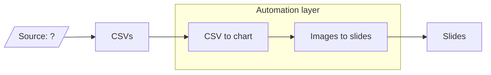

# lidl-automation

Automation that turns CSV data into chart images and assembles them into slides.

## Pipeline

## Open questions

1. Where do the CSVs come from (the "Source: ?" box)?
2. Where does the automation run?
   1. Google Apps Script
   2. Cloud Run (GCP)
