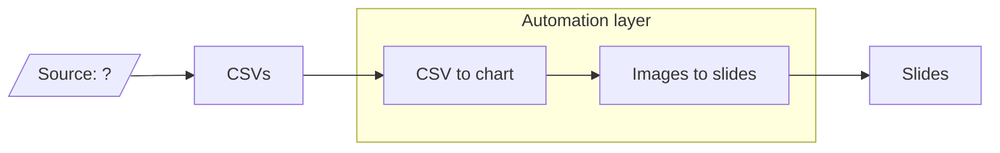

# lidl-automation

Automation that turns CSV data into chart images and assembles them into slides.

## Pipeline



## Usage

Requires [uv](https://docs.astral.sh/uv/). Put the Excel exports in `data/` (git-ignored).

```sh
uv run charts.py   # data/*.xlsx -> charts/*.png + charts/*.txt (captions)
uv run slides.py   # charts/ -> one slide per chart in the Google Slides deck
```

`slides.py` replaces the slides it created on a previous run, so it is safe to re-run.

### Google auth (one-time)

`slides.py` uses Application Default Credentials. The quota project needs the Slides and Drive APIs enabled.

```sh
gcloud auth application-default login --scopes=openid,https://www.googleapis.com/auth/userinfo.email,https://www.googleapis.com/auth/cloud-platform,https://www.googleapis.com/auth/presentations,https://www.googleapis.com/auth/drive.file
gcloud auth application-default set-quota-project <project-id>
```

## Open questions

1. Where do the CSVs come from (the "Source: ?" box)?
2. Where does the automation run?
   1. Google Apps Script
   2. Cloud Run (GCP)
