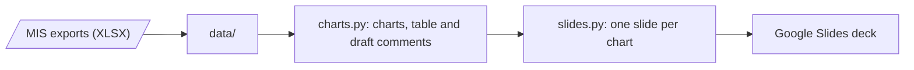

# lidl-automation

Automates the *Stückleistung* section of the weekly report: the MIS exports go in, the section's charts, tables and draft comments come out in Google Slides.

## How it works



| File | Does |
|---|---|
| [`charts.py`](charts.py) | Reads the exports in `data/`, checks their format, writes chart and table images to `charts/` with a draft comment (`.txt`) for each |
| [`slides.py`](slides.py) | Inserts each image and its comment as a slide in the Google Slides deck; a re-run replaces the slides from the previous run |

`data/` and `charts/` are git-ignored, so no client data is committed.

### Inputs

| File | Content | Granularity |
|---|---|---|
| `Input stuckleistung_daredata.xlsx` | Stückleistung, units sold and hours, with deltas vs. VJ (prior year), PEP and Plan | Week × Region (SAN, TON, LOU, PAL + Gesamt) |
| `Input stuckleistung_daredata_top_flop.xlsx` | Stückleistung, Δ VJ and Δ Plan | Week × Store (~316 stores) |

- Store-level Δ VJ and Δ Plan are absolute differences in units/hour, not percentages.
- A store at 0 units/hour in a week has no data or was closed that week; it is excluded from Top/Flop.
- Values for recent weeks are revised afterwards, mainly the hours.

## Setup (one-time)

You need:

- [uv](https://docs.astral.sh/uv/getting-started/installation/), which installs Python and the dependencies on first run.
- The [gcloud CLI](https://cloud.google.com/sdk/docs/install).
- **Edit access** to the Google Slides deck. Its ID is `PRESENTATION_ID` at the top of [`slides.py`](slides.py); change it to target another deck.
- A **GCP project** with the Google Slides and Google Drive APIs enabled. The project doesn't host anything here; Google bills and rate-limits the API calls against it, and both APIs are free. We use `daredata-chatbot`.

**1. Enable the APIs in the project.** Do this once per project. It needs permission to enable services, e.g. the *Service Usage Admin* role; otherwise ask a project admin.

```sh
gcloud auth login
gcloud services enable slides.googleapis.com drive.googleapis.com --project daredata-chatbot
```

**2. Create local credentials with Slides and Drive access.** `slides.py` uses Application Default Credentials, i.e. your own Google account. The scope list keeps `cloud-platform`, so other tools that rely on these credentials keep working. If no browser opens (e.g. on WSL), open the printed URL yourself.

```sh
gcloud auth application-default login --scopes=openid,https://www.googleapis.com/auth/userinfo.email,https://www.googleapis.com/auth/cloud-platform,https://www.googleapis.com/auth/presentations,https://www.googleapis.com/auth/drive.file
gcloud auth application-default set-quota-project daredata-chatbot
```

Setting the quota project needs permission to use services in the project, e.g. the *Service Usage Consumer* role.

## Run end to end

In a terminal:

```sh
git clone https://github.com/hjoaquim/lidl-automation.git && cd lidl-automation

# 1. Drop this week's MIS exports into data/ (file names as in Inputs above)
mkdir -p data && cp /path/to/exports/*.xlsx data/

# 2. Build the images and draft comments
uv run charts.py
#    -> charts/1_stueckleistung_trend.png + .txt, ..., charts/5_kpi_table.png + .txt

# 3. Put them in the deck
uv run slides.py
#    -> Inserted 5 slides: https://docs.google.com/presentation/d/<id>/edit
```

Open the printed link. `slides.py` adds one slide per image after the first slide, with its draft comment underneath. Running it again replaces those slides instead of adding more, so you can re-run as often as needed. It leaves every other slide in the deck untouched.

The week shown is always the most recent one in the exports. To show a new week, replace the files in `data/` and run steps 2 and 3 again.

## Troubleshooting

| Error | Fix |
|---|---|
| `Input ... .xlsx: unexpected format, missing columns: [...]` | The export's format changed. Re-export it with the expected columns, or update the column names at the top of `charts.py`. |
| `No charts in charts/, run charts.py first` | Run `uv run charts.py` before `slides.py`. |
| `403 ... insufficient authentication scopes` | Your local credentials lack Slides or Drive access. Redo step 2 of the setup. |
| `403 ... API has not been used in project ... or it is disabled` | Enable the APIs (step 1), or point the quota project at a project where they are enabled. |
| `403 ... The caller does not have permission` on the deck | Your Google account needs edit access to the deck. |
| `Reauthentication failed` or `invalid_grant` | Your login expired. Redo step 2. |

## Open questions

- What are the exact rules for excluding stores from Top/Flop?
- Is the "Δ Plan %" on the Top/Flop slide actually a difference in units/hour?
- Is Monday-morning data provisional? When does it become final?
- Can the MIS export daily values, month-to-date values, Δ vs. Plan year-to-date, and sales per store?
