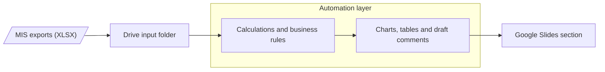

# lidl-automation

Automates the *Stückleistung* section of the weekly report: the MIS exports go in, the section's charts, tables and draft comments come out in Google Slides.

## Pipeline



There are two ways to build the automation layer. **[docs/handover.md](docs/handover.md)** compares them step by step and lists the open questions.

| | Python (this repo) | Google Apps Script |
|---|---|---|
| Status | Working prototype, used to validate figures and rules | Proposed long-term solution |
| Logic lives in | Code | An "engine" Google Sheet the team can edit |
| Runs on | Laptop, or Cloud Run (GCP) | The client's Google Workspace |

## Python prototype

| File | Does |
|---|---|
| [`charts.py`](charts.py) | Reads the exports in `data/`, checks their format, writes chart and table images to `charts/` with a draft comment (`.txt`) for each |
| [`slides.py`](slides.py) | Inserts each image and its comment as a slide in the Google Slides deck; a re-run replaces the slides from the previous run |

Requires [uv](https://docs.astral.sh/uv/). Put the Excel exports in `data/` (git-ignored, like `charts/`, so no client data is committed).

```sh
uv run charts.py
uv run slides.py
```

### Google auth (one-time, for `slides.py`)

`slides.py` uses Application Default Credentials. The quota project needs the Google Slides and Google Drive APIs enabled.

```sh
gcloud auth application-default login --scopes=openid,https://www.googleapis.com/auth/userinfo.email,https://www.googleapis.com/auth/cloud-platform,https://www.googleapis.com/auth/presentations,https://www.googleapis.com/auth/drive.file
gcloud auth application-default set-quota-project <project-id>
```
